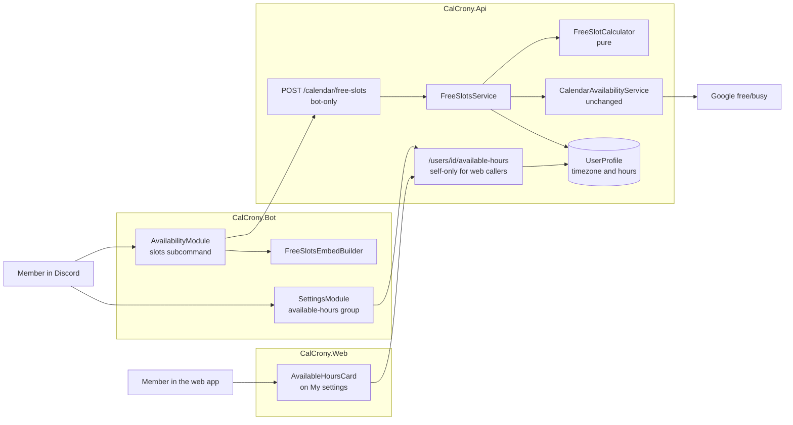

# Free slots and available hours — application design

**Date**: 2026-11-11. **Inputs**: the approved requirements (FR1–FR18; Q1–Q7: A, A, B, A, A, A, A)
and the approved workflow plan. **Baseline**: `master` 4911a1f (v0.36.3).
**Status**: approved by Joshua 2026-11-11, as written. **Amended 2026-11-12** with D11 (section 2),
on his decision after the review of unit 1; 5.1, 5.2, section 7 and section 8 are brought in line.

This document covers both units of work so the seam between them is drawn once. It fixes components,
contracts, routes, storage and command shapes; the detailed rules of each unit (validation messages,
edge cases, verified file anchors, the step list) follow in that unit's code-generation plan.

## 1. Shape of the change



The same in words: a member runs `/availability slots`; the bot's module resolves the target to
user ids and calls the bot-only route; `FreeSlotsService` loads each member's timezone and hours
from `UserProfile`, asks the unchanged `CalendarAvailabilityService` for busy blocks (one Google
call per linked member), hands both to the pure `FreeSlotCalculator`, and the bot renders the
answer with `FreeSlotsEmbedBuilder`. A member's hours are written through their own routes, from
the bot's `/settings available-hours` commands or the web's My settings card. Everything on the
right of the diagram except the hours routes and the stored hours ships in unit 1.

## 2. Decisions made here

Each is a choice the requirements left to design. The rejected alternative is named so it can be
overruled.

| # | Decision | Instead of | Why |
|---|---|---|---|
| D1 | Hours are stored as one nullable JSON text column on `UserProfile`, `AvailableHoursJson`. Null means "never set". | A child table per weekday, or a Postgres array column | Seven small entries read and written whole with the profile: one row, no join, and the precedent is `EventSeries.RsvpOptionsJson`. The slots route already loads the profile for the timezone. |
| D2 | Hours travel on routes of their own — `GET`, `PUT`, `DELETE /users/{userId}/available-hours` — not as a field on `UserSettingsDto`. | A null-keeps field on the settings DTO | FR14 (other settings writers can't wipe hours) becomes structural: they never carry the field. Read-modify-write on settings DTOs has cost fixes before — the native-events flag at all three server-settings write sites — and the user DTO has needed a null-keeps rule for each field added since. |
| D3 | A time of day is minutes from midnight in 30-minute steps (0–1440, the end may be 1440); a weekday is the BCL `DayOfWeek`. | `TimeOnly`, or NodaTime types in Contracts | Midnight as an end is not a `TimeOnly`; Contracts has no package references today and keeps none. |
| D4 | The slot calculation takes, per member, a zone, a week of hours and busy blocks. Unit 1 passes the default week for everyone; unit 2 changes only where the week comes from. | Unit 1 with one fixed window, generalised later | The calculation and its tests are final in unit 1. |
| D5 | The query reaches one day past the last requested day, and a slot is kept when it *starts* inside the range. | Clipping at the last midnight | A slot that starts at 10 PM on the last day shows its real end, and isn't dropped for looking shorter than the minimum. |
| D6 | `/settings available-hours` is a subcommand group — `set`, `off`, `reset` — nested in `SettingsModule`. | One subcommand with optional `from`, `to`, `off`, `reset` options | Every option is required and means one thing. The nested class carries the same context attributes, which the module-context pin test requires of every module type. |
| D7 | "Available on no day" cannot be stored. The API rejects an empty week; the bot and the web card refuse it and point at reset. | The requirements' assumption that saving no day resets to the default | A member who switches every day off means "never", and silently giving them 8 AM–11 PM every day would be the opposite. |
| D8 | Limits live once in Contracts (`FreeSlotLimits`, `AvailableHoursLimits`) and are used by the bot's option bounds and the API's validation. | The two copies of `MaxUsersPerQuery` kept in step by hand | They can't drift. The existing constants are left as they are. |
| D9 | The member-zone rule (their timezone, else the server's, else UTC) is a small pure helper used by the new code. The datetime route keeps its own inline copy, and a test pins that both give the same answer. | Refactoring the datetime route onto the helper | No behaviour risk to every command that parses `when:`. |
| D10 | Saving hours writes no activity-log entry. | Logging it | The log records server management actions; personal settings are not logged today. |
| D11 | *Added 2026-11-12 (FR19).* A single target other than the caller is listed only when that member has saved their own hours. Unit 1 has no saved hours, so there `who:` takes the caller or a role, and the bot refuses anyone else before any lookup. Unit 2 lifts the refusal for a member with saved hours, and every place where hours are saved or shown says that saving them lets other members list one's slots by name, and that such a list shows roughly the hours one keeps (FR10). How the bot learns that hours are saved is for unit 2's plan; the hours `GET` route already answers it (`IsSet`). | The design as approved, where any member of the server could be named; or a separate per-member switch, on or off by default | Naming any linked member reaches further than `/availability role`, which gets to a member only through a role of 50 or fewer. Saving hours is already the act of saying when one is available, so no second setting is needed, and reset is the way back. A role is left as it is: it reaches what the grid reaches, with one difference — bots are left out before the 50-member limit here and counted toward it there. |

## 3. Contracts (`CalCrony.Contracts`)

```csharp
// Unit 1 — Calendar.cs
public static class FreeSlotLimits
{
    public const int MaxUsers = 50;
    public const int DefaultDays = 7;
    public const int MaxDays = 14;
    public const int DefaultMinimumMinutes = 60;
    public const int MinMinimumMinutes = 15;
    public const int MaxMinimumMinutes = 1440;
}

public record FreeSlotsRequest(
    IReadOnlyList<long> UserIds, long RequesterId, long GuildId,
    string? When, int Days, int MinimumMinutes);

public enum FreeSlotMemberState
{
    Counted = 0,            // calendar read, own hours             (unit 2)
    DefaultHours = 1,       // calendar read, no hours saved: 8 AM–11 PM applied
    HoursOnly = 2,          // hours saved, no calendar linked      (unit 2)
    NotCounted = 3,         // no hours and no calendar
    ReconnectRequired = 4,  // calendar linked, refresh rejected: not counted
    Error = 5,              // calendar linked, query failed: not counted
}

public record FreeSlotMemberDto(long UserId, FreeSlotMemberState State);
public record FreeSlotDto(DateTimeOffset StartUtc, DateTimeOffset EndUtc);   // StartUnix, EndUnix
public record FreeSlotDayDto(DateOnly Date, IReadOnlyList<FreeSlotDto> Slots);
public record FreeSlotsResponse(
    string TimeZone, DateOnly FirstDay, DateOnly LastDay, int CountedMembers,
    IReadOnlyList<FreeSlotDayDto> Days, IReadOnlyList<FreeSlotMemberDto> Members);

// Unit 2 — Calendar.cs
public static class AvailableHoursLimits
{
    public const int StepMinutes = 30;
    public const int DefaultStartMinute = 480;    // 8:00 AM
    public const int DefaultEndMinute = 1380;     // 11:00 PM
}

public record AvailableHoursDayDto(DayOfWeek Day, int StartMinute, int EndMinute);
public record AvailableHoursDto(bool IsSet, IReadOnlyList<AvailableHoursDayDto> Days);
public record SetAvailableHoursRequest(IReadOnlyList<AvailableHoursDayDto> Days);
```

The whole state enum is defined in unit 1 so the contract doesn't change shape in unit 2; unit 1
only ever returns `DefaultHours`, `NotCounted`, `ReconnectRequired` and `Error`. A day missing from
`Days` is unavailable. When nothing is saved, `GET` returns `IsSet: false` with the default week, so
both surfaces can show what applies.

## 4. API (`CalCrony.Api`)

### 4.1 Components

| Component | Kind | Responsibility | Unit |
|---|---|---|---|
| `NaturalDateTimeParser.TryResolveDay` | new method | Resolve text to a local date in a zone. Today or later is accepted (today all day long); a bare date, a date with a time and a range all reduce to their date. | 1 |
| `WeeklyHours` | new type, `Services/` | A week of at most one range per weekday. `Default` is 8 AM–11 PM every day. Unit 2 adds validation from the DTO, the JSON round-trip and the DTO projection. | 1, 2 |
| `FreeSlotCalculator` | new static class, pure | From "now", the caller's zone, the first day, the day count, the minimum length and each counted member's zone, week and busy blocks: the slots, grouped by the caller's days. | 1 |
| `MemberZone` | new static helper, pure | A member's zone: their timezone, else the server's, else UTC (D9). | 1 |
| `FreeSlotsService` | new scoped service | Orchestrates: caller zone, first day, profiles, the availability check, member states, the calculation, the response. | 1; unit 2 reads stored hours and adds `Counted` and `HoursOnly` |
| `CalendarEndpoints` | changed | Maps `POST /calendar/free-slots` (bot-only) and validates the request. | 1 |
| `UserProfile.AvailableHoursJson` | new column | The stored week (D1). Migration `AddAvailableHours`: one nullable text column. | 2 |
| `SettingsEndpoints` | changed | Maps the three hours routes with the existing self-only guard for web callers. | 2 |
| `CalendarAvailabilityService`, `GoogleCalendarProvider`, the existing availability routes | unchanged | Called as they are. | — |

### 4.2 Methods

```csharp
// NaturalDateTimeParser
public bool TryResolveDay(string text, DateTimeZone zone, out LocalDate day, out string? error,
    Instant? referenceInstant = null);

// WeeklyHours
public static WeeklyHours Default { get; }
public (int StartMinute, int EndMinute)? RangeFor(IsoDayOfWeek day);
public static bool TryFromDto(IReadOnlyList<AvailableHoursDayDto> days,
    out WeeklyHours? hours, out string? error);                         // unit 2
public static WeeklyHours? Parse(string? json);                         // unit 2; null in, null out
public string Serialize();                                              // unit 2
public IReadOnlyList<AvailableHoursDayDto> ToDto();                     // unit 2

// FreeSlotCalculator
public sealed record FreeSlotQuery(Instant Now, DateTimeZone CallerZone, LocalDate FirstDay,
    int Days, Duration Minimum);
public sealed record MemberAvailability(DateTimeZone Zone, WeeklyHours Hours,
    IReadOnlyList<(Instant Start, Instant End)> Busy);
public sealed record FreeSlotDay(LocalDate Date, IReadOnlyList<(Instant Start, Instant End)> Slots);

public static (Instant Start, Instant End) QueryWindow(FreeSlotQuery query);
public static IReadOnlyList<FreeSlotDay> Compute(FreeSlotQuery query,
    IReadOnlyList<MemberAvailability> members);

// MemberZone
public static DateTimeZone Resolve(string? memberTimeZone, string? guildTimeZone);

// FreeSlotsService
public Task<FreeSlotsOutcome> GetAsync(FreeSlotsRequest request, CancellationToken cancellationToken);
// FreeSlotsOutcome: the response, or a user-facing error for a 400.
```

### 4.3 Routes

| Route | Caller | Request → response | Refusals (400 unless noted) |
|---|---|---|---|
| `POST /calendar/free-slots` | bot only | `FreeSlotsRequest` → `FreeSlotsResponse` | no ids or more than 50 distinct; `Days` outside 1–14; `MinimumMinutes` outside 15–1440; `When` not understood; the day is already over |
| `GET /users/{userId}/available-hours` | the bot, or the member themself on the web | → `AvailableHoursDto` | 403 for another member's id from the web |
| `PUT /users/{userId}/available-hours` | same | `SetAvailableHoursRequest` → `AvailableHoursDto` | no day; a weekday twice; a time off the 30-minute grid or outside 0–1440; a start not before its end; 403 as above |
| `DELETE /users/{userId}/available-hours` | same | → 204; the member is back on the default | 403 as above |

The free-slots route stays bot-only for the reason the existing availability route is: it accepts
arbitrary user ids, and a web caller could probe any member with it.

### 4.4 The calculation, in outline

1. **Range.** It starts at the later of the first day's midnight in the caller's zone and "now"
   rounded up to the next quarter hour. Slots must start before the midnight that ends the last
   requested day; the window queried and computed runs one day further (D5).
2. **Each counted member's availability.** For every local date in that member's zone that touches
   the window, the range for that weekday becomes an interval (local times mapped leniently, so a
   daylight-saving day keeps its wall-clock hours). Their merged busy blocks are subtracted.
3. **Everyone at once.** The members' interval lists are intersected; touching intervals are merged,
   so a stretch across midnight is one slot.
4. **Slots.** Keep intervals that start inside the range and are at least the minimum long; group
   them by the caller's local date of their start; every requested day appears, with or without
   slots.

### 4.5 Member states

| Linked calendar | Hours saved | State | Counted | Hours used |
|---|---|---|---|---|
| read | yes | `Counted` | yes | their own |
| read | no | `DefaultHours` | yes | 8 AM–11 PM every day |
| none | yes | `HoursOnly` | yes | their own; no busy blocks |
| none | no | `NotCounted` | no | — |
| needs to reconnect | either | `ReconnectRequired` | no | — |
| couldn't be read | either | `Error` | no | — |

Unit 1 has no saved hours, so every member is in a "no" row of the second column. When nobody is
counted the response carries no days.

## 5. Bot (`CalCrony.Bot`)

### 5.1 Commands

| Command | Options | Unit |
|---|---|---|
| `/availability slots` | `who` — member or role (required, Discord's mentionable picker); the member is the caller in unit 1, and from unit 2 may be another member who has saved their hours (D11) · `when` — first day, natural language (optional, default today) · `days` — 1 to 14 (optional, default 7) · `duration` — minimum minutes, 15 to 1440 (optional, default 60) | 1 |
| `/settings available-hours set` | `days` — every day, weekdays, weekends, or one weekday (required) · `from`, `to` — times with suggestions in 30-minute steps; typed values such as `6:30pm` or `18:30` are accepted, and `to` may be midnight (required) | 2 |
| `/settings available-hours off` | `days` — as above (required) | 2 |
| `/settings available-hours reset` | none | 2 |
| `/settings view` | gains the line "Your available hours" | 2 |

`set` and `off` change the days named and leave the others as they were; a first `set` starts from
an empty week, so days not named are unavailable. Every reply spells out the whole week and the zone
it is read in. An `off` that would leave no day is refused (D7).

### 5.2 Components

| Component | Kind | Responsibility | Unit |
|---|---|---|---|
| `AvailabilityModule.SlotsAsync` | new subcommand | Resolve `who` to user ids — a role through the existing member download and the 50 cap, a member directly, under D11 — call the route, reply ephemerally with the embed or the refusal. | 1; unit 2 lets another member be named once they have saved hours (D11) |
| `FreeSlotsEmbedBuilder` | new static class, pure | Render the response (5.3). | 1; unit 2 adds the notes for `Counted`, `HoursOnly` and `DefaultHours` |
| `CalCronyApiClient` | changed | `GetFreeSlotsAsync`; in unit 2 `GetAvailableHoursAsync`, `PutAvailableHoursAsync`, `ResetAvailableHoursAsync`. | 1, 2 |
| `SettingsModule.AvailableHoursGroup` | new nested group | The three hours commands, read-modify-write through the hours routes. | 2 |
| `TimeOfDayText` | new static class, pure | Parse a typed time to minutes; format minutes as text. | 2 |
| `TimeOfDayAutocompleteHandler` | new handler | Suggestions for `from` and `to`; the suggestion shaping is a pure, tested method, as on `TimeZoneAutocompleteHandler`. | 2 |
| `AvailableHoursText` | new static class, pure | Apply a days choice to a week; describe a week in one line ("Mon–Fri 6:00 PM–11:00 PM · Sat, Sun 10:00 AM–11:00 PM"). | 2 |

### 5.3 The reply

- **Title**: "Free slots for" and the target's plain name (mention markup does not render in titles).
- **Description**: the range and the minimum length; one sentence saying what the slots rest on;
  then one line per day — the day in the bot's existing `ddd MMM d` style, its slots as Discord
  timestamps, or "nothing free". A day lists at most six slots, then "+N more".
- **A field below**, only when there is something to say: members grouped by state — hours only,
  default hours assumed, not counted, needs to reconnect, couldn't check — as mentions, cut at
  Discord's 1024-character field limit with "+N more".
- **Footer**: the zone the days are cut in, and that times show in the reader's local time.
- **Nobody counted**: no day lines; the sentence says how to be counted (`/calendar connect`, and
  from unit 2 `/settings available-hours set`).
- **Budget**: fourteen days of six slots each is about 3,400 characters of description against
  Discord's 4,096, and the whole embed stays under 6,000. A test builds that worst case.

## 6. Web (`CalCrony.Web`) — unit 2

| Component | Kind | Responsibility |
|---|---|---|
| `CalCronyWebApiClient` | changed | `GetAvailableHoursAsync`, `PutAvailableHoursAsync`, `ResetAvailableHoursAsync`. |
| `AvailableHoursCard.razor` | new component | Seven rows, Monday first: available, from, to (30-minute steps; "to" offers midnight). Save and Reset to default. When nothing is saved it says the default applies and shows that week. Save is disabled while no day is ticked or a row's times are out of order (D7). States which zone the times are read in. |
| `UserSettings.razor` | changed | Hosts the card under the existing two. |

Slots get no web view: the route is bot-only by design.

## 7. Docs and privacy

| File | Unit 1 | Unit 2 |
|---|---|---|
| `README.md` Features | The "Reminders & calendars" bullet names free slots. The section is close to its 400-word cap (about 396 words by a quick count), so the bullet is reworded, not lengthened. | The same bullet names available hours, inside the cap; "free slots for yourself or a role" becomes "a member or role" again (D11). |
| `README.md` command table | A row for `/availability slots`. | The `/settings` row gains `available-hours`; the slots row says a member can be named once they have saved hours (D11). |
| `Docs.razor` | The availability entry gains the slots sentence — Discord only, any member, ephemeral, 8 AM–11 PM assumed; a command row. | An "Available hours" entry — both surfaces, only you can set yours, the default, how hours without a calendar count; the `/settings` row. The rule for naming another member, in the hours entry and the slots sentence: saving hours lets other members list your slots by name, which shows roughly the hours you keep, and reset takes it back (D11, FR10). |
| `PRIVACY_POLICY.md`, `Privacy.razor` | "availability grids and free-slot lists" in the Google Limited Use sentence; the date. | Available hours under Preferences, with what saving them allows: other members can list your slots by name, which shows roughly the hours you keep (D11, FR10); the DM-reminder wording brought level between the copies; the date. |
| `aidlc-docs/construction/build-and-test/live-e2e-script.md` | A slots section. | An hours section. |

`Docs.razor` and `Privacy.razor` are product surface, so both PRs are `feat:`.

## 8. Units of work

| | Unit 1 — `free-slots` | Unit 2 — `available-hours` |
|---|---|---|
| Ships | `/availability slots` end to end; every counted member on the default hours; a single target is the caller (D11) | The stored setting on both surfaces; slots read it; "hours only"; another member can be named once they have saved hours (D11) |
| Contracts | `FreeSlotLimits`, the request, response, slot, day and member records, the state enum | `AvailableHoursLimits`, the hours records |
| API | `TryResolveDay`, `WeeklyHours` (default only), `MemberZone`, `FreeSlotCalculator`, `FreeSlotsService`, the route | The column and migration, `WeeklyHours` validation and JSON, the three routes, `FreeSlotsService` reading stored hours |
| Bot | The subcommand, the embed builder, one client method | The command group, the two time helpers, the autocomplete handler, the `view` line, the embed notes, three client methods |
| Web | — | Three client methods, the card, the page |
| Docs | Section 7, unit 1 column | Section 7, unit 2 column |
| Tests | Calculator; day resolution; the route on the fake provider, including the zone pin of D9; the embed, including its worst case; the Docs page | Week validation and round-trip; the hours routes (validation, self-only, a settings write leaves hours alone); slots with stored hours, hours only and members in different zones; time parsing and formatting; the week description; suggestions; the registered command tree; the embed notes; the web card; the Docs page; naming a member with and without saved hours (D11) |
| Migration | none | one nullable column; rolling the image back stays safe |
| Requirements | FR1, FR2, FR4–FR9, FR13, FR16; FR3 without "hours only"; half of FR17 and FR18; FR19 as it applies before hours exist | FR10–FR12, FR14, FR15; the rest of FR3, FR17, FR18 and FR19 |
| Depends on | — | Unit 1 (D4) |

For the live pass, because no test can cover them: Discord accepting the mentionable option and the
nested `/settings available-hours` group at registration; a fourteen-day free/busy query against a
real Google account; the reply at phone width.

## 9. Not changed, by design

- `/availability role`, `/availability event`, their embed, the event page's grid and its route.
- `CalendarAvailabilityService`, `GoogleCalendarProvider`, the OAuth flow and scope (ADR 0003).
- `UserSettingsDto` and `PUT /users/{id}/settings`.
- The datetime route and every command that parses `when:` (D9).
- Permissions, intents, configuration, containers.

## 10. Design checklist

- [x] Requirements, workflow plan and the affected code read (API settings and calendar routes, the
      bot's settings and availability modules and autocomplete, the web settings page, both privacy
      copies, the module-context pin test)
- [x] Components, methods, routes and contracts defined for both units
- [x] Storage and wire decisions recorded with the alternative rejected (section 2)
- [x] Units of work, their dependency and the requirement map written (section 8)
- [x] Diagram's syntax checked; text alternative provided
- [x] Approved by Joshua — 2026-11-11, as written ("Continue")
- [x] D11 added 2026-11-12 on Joshua's decision (option A, "I agree with your recommendations")
