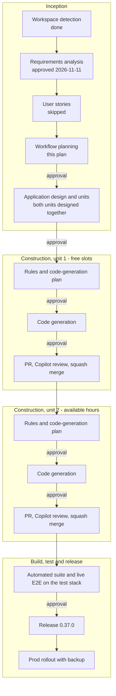

# Free slots and available hours — workflow plan

**Date**: 2026-11-11. **Input**: the approved requirements
(`inception/requirements/availability-free-slots-requirements.md`; Q1–Q7: A, A, B, A, A, A, A).
**Baseline**: `master` 4911a1f (v0.36.3). **Status**: approved by Joshua 2026-11-11, as written.

Every recommendation here can be overridden; section 6 lists the ones most worth a second look.

## 1. Stages

| Stage | Decision | Depth | Output | Gate |
|---|---|---|---|---|
| Workspace detection | Done 2026-11-10 | — | audit entry | — |
| Reverse engineering | Skipped | — | — | — |
| Requirements analysis | Done, approved 2026-11-11 | Standard | the requirements document | passed |
| User stories | **Skip** | — | — | this plan |
| Workflow planning | This document | — | this file | **approval** |
| Application design | **Execute** | Standard | `inception/application-design/availability-free-slots-design.md` | **approval** |
| Units generation | **Execute**, inside the design document | Minimal | its "Units of work" section | the same approval |
| Functional design, per unit | **Execute**, as the first part of the unit's code-generation plan | Minimal | `construction/plans/<unit>-code-generation-plan.md` | with that plan |
| NFR requirements, NFR design | **Skip** | — | — | — |
| Infrastructure design | **Skip** | — | — | — |
| Code generation, per unit | **Execute** | — | the plan with checkboxes, then code and tests | **approval** of the plan, **approval** on completion |
| Build and test | **Execute** | The repo's collapsed form | suite green, new sections in `live-e2e-script.md`, summary updated | **approval** before the release |

Why each skip or merge:

- **Reverse engineering** — the codebase was built under this workflow; `aidlc-state.md`, ADRs
  0001–0004 and the Docs page are its architecture record, and the requirements document analyses
  the sites this change touches.
- **User stories** — on paper it qualifies: a new user-facing feature with two kinds of user, the
  member who declares their hours and the member looking for a time. It is skipped as on every
  feature in this project, because one stakeholder answers the design questions directly and the
  requirements already say who does what, one testable requirement at a time. What stories would
  add — an acceptance walk-through per kind of user — is written anyway as the new live E2E sections.
- **Application design and units in one document** — both units are designed together so the seam
  between them (how the slot calculation receives each member's hours) is drawn once. The document
  carries the sections the standard layout splits into files: components, their methods, services,
  dependencies, units of work and the requirement map.
- **Functional design inside the code-generation plan** — the pattern of the RSVP v2 plans: locked
  decisions, rules, data model and verified file anchors first, then the checkbox steps, approved
  together.
- **NFR stages** — the stack is fixed, and the limits that matter are already requirements: 50
  members, 14 days, one Google call per linked member, the embed budget, nothing from Google stored.
- **Infrastructure design** — the same four containers; no new configuration, volume or secret.
  Unit 2's migration applies the way every earlier one has.

## 2. Units of work

| Unit | What ships | Migration | Requirements |
|---|---|---|---|
| **1 — `free-slots`** | `/availability slots` end to end, with every member on the default hours (8 AM–11 PM) and only members with a readable calendar counted | none | FR1, FR2, FR4–FR9, FR13, FR16; FR3 without "hours only"; the slots half of FR17 and FR18 |
| **2 — `available-hours`** | The stored setting in Discord and on the web; slots read it; a member with hours and no calendar is counted as "hours only" | one, additive | FR10–FR12, FR14, FR15; the "hours only" part of FR3; the hours half of FR17 and FR18 |

Unit 2 depends on unit 1: the calculation takes each member's weekly hours as an input from the
start, so unit 2 changes where those hours come from, not how slots are computed.

## 3. Change sequence

Layer order within each unit, tests written alongside each layer:

1. **Unit 1** — Contracts (request, response, member status) → API (day-level resolver on the
   natural-language parser, the pure slot calculation, the bot-only route) → Bot (API client method,
   the `slots` subcommand, the embed builder) → docs (README bullet and rows, Docs page entry and
   row, "free-slot lists" in both privacy copies).
2. **Unit 2** — Contracts (hours) → API (entity and migration, reading and writing hours with
   validation, the slots route reading stored hours, the "hours only" state) → Bot (the hours
   commands, time suggestions, the `/settings view` line, the reply notes) → Web (client methods, the
   My settings card) → docs (README, Docs page, privacy Preferences line with the DM-reminder
   wording brought level).

## 4. Delivery

- **Tracking**: one GitHub issue for the feature with a box per unit, as the earlier roadmap features
  had; the Discord requester can be pointed at it.
- **Branches**: `feature/availability-free-slots`, then `feature/available-hours`, each cut from the
  current `master`. The first commit on the first branch carries the inception documents.
- **PR titles** (the squash commit, so conventional commits): `feat: free slots for a member or role
  (/availability slots)` and `feat: per-member available hours for free slots`.
- **Review**: Copilot rounds until an approval with no open threads; `build-test` and `pr-title`
  green; squash merge.
- **After each merge**: the test stack picks up `:main`.
- **Release**: one release, 0.37.0, after both units are merged — the release PR that
  release-please opens after unit 1 stays open until unit 2 lands.
- **Prod**: backup first, then the pinned tag, by the standing procedure. Both units are additive, so
  rolling the image back stays safe.
- **Nothing is pushed, opened, merged or released without a go-ahead.** The issue, each PR, each
  merge, the release and the prod rollout are asked for at the gate before them.

## 5. Workflow at a glance

The same in words:

1. **Inception** — workspace detection (done) → requirements analysis (approved) → user stories
   (skipped) → workflow planning (this plan) → *approval* → application design and units → *approval*.
2. **Unit 1, free slots** — rules and code-generation plan → *approval* → code generation →
   *approval* → PR, Copilot review, squash merge.
3. **Unit 2, available hours** — the same three steps.
4. **Build, test and release** — the automated suite and the live E2E pass on the test stack →
   *approval* → release 0.37.0 → prod rollout with backup.

## 6. Worth a second look

- **User stories are skipped.** This feature came from a community member rather than from the
  roadmap; if a story-per-user acceptance list is wanted for that reason, it is one short document.
- **Two PRs, one release.** The alternatives are one PR for everything (a larger review — this repo's
  longest review loops were on its largest PRs) or a release after each unit (slots would ship for a
  while with everyone on the default hours).
- **Both units are designed up front.** The alternative — designing unit 2 after unit 1 ships —
  risks reworking the calculation's inputs.
- **No web view of slots.** The route stays bot-only for the reason the existing one is: a web caller
  could otherwise probe any member's free/busy.

## 7. Plan checklist

- [x] Prior context loaded: requirements, state file, audit trail, `CONTRIBUTING.md`, the
      build-and-test summary
- [x] Stages and depths decided
- [x] Units of work and change sequence drafted
- [x] Diagram written, its syntax checked, text alternative provided
- [x] Approved by Joshua — 2026-11-11, as written ("Approve plan")
