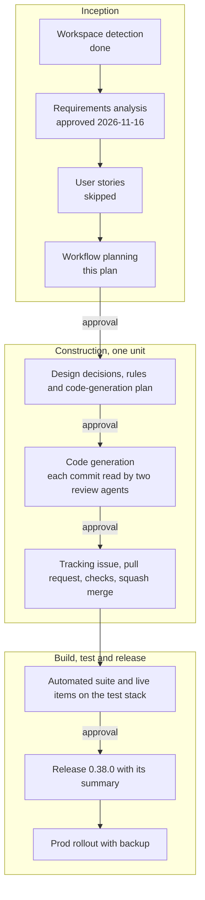

# Free slots count CalCrony events — workflow plan

**Date**: 2026-11-16. **Input**: the approved requirements
(`inception/requirements/free-slots-calcrony-events-requirements.md`, FR20–FR31; Q1–Q5: A, A, A,
A, A). **Baseline**: `master` 4af1305 — the code of v0.37.0, which prod runs, and the
release-summary tooling added after it. **Status**: approved by Joshua 2026-11-16, as written.

Every recommendation here can be overridden; section 6 lists the ones most worth a second look.

## 1. Stages

| Stage | Decision | Depth | Output | Gate |
|---|---|---|---|---|
| Workspace detection | Done 2026-11-16 | — | audit entry | — |
| Reverse engineering | Skipped | — | — | — |
| Requirements analysis | Done, approved 2026-11-16 | Standard | the requirements document | passed |
| User stories | **Skip** | — | — | this plan |
| Workflow planning | This document | — | this file | **approval** |
| Application design | **Execute**, as the first part of the code-generation plan | Minimal | decisions D12 onwards in that plan, added to `inception/application-design/availability-free-slots-design.md` | with that plan |
| Units generation | **Skip** | — | — | — |
| Functional design | **Execute**, in the same first part | Minimal | the rules, in `construction/plans/free-slots-calcrony-events-code-generation-plan.md` | with that plan |
| NFR requirements, NFR design | **Skip** | — | — | — |
| Infrastructure design | **Skip** | — | — | — |
| Code generation | **Execute** | — | the plan with checkboxes, then code and tests | **approval** of the plan, **approval** on completion |
| Build and test | **Execute** | The repo's collapsed form | suite green, new items in section 12 of `live-e2e-script.md`, summary updated | **approval** before the release |

Why each skip or merge:

- **Reverse engineering** — as for free slots: the codebase was built under this workflow, the
  state file, ADRs 0001–0004 and the Docs page are its architecture record, and the requirements
  document analyses the sites this change touches.
- **User stories** — on paper the change qualifies, since it alters what members see. It is
  skipped as on every feature in this project: one stakeholder answers the design questions
  directly, and FR20–FR31 are testable one at a time. What a story would add is written anyway as
  the new live items: a game master books a session, and the slot is gone from their list.
- **Application design inside the code-generation plan** — the change stays inside one existing
  component, the free-slots lookup: one more source of busy time, read in the API and handed to
  the calculation that exists. The requirements leave a few points to design: whether an index is
  needed, the shape of the database reads, how the work per series is bounded when a lookup
  starts far ahead, and the field by which the API says that events were counted. They are few
  and technical, so they are written as numbered decisions at the top of the code-generation
  plan, continuing the design document's list (D1–D11), each with the alternative it rejects, and
  are approved with the plan. The design document gets them as an amendment, the way D11 was
  added.
- **Units generation** — one unit and one pull request; there is nothing to split.
- **Functional design inside the code-generation plan** — the pattern of the earlier plans:
  locked decisions, rules and verified file anchors first, then the checkbox steps, approved
  together. The reply's wording is drafted there too, as the requirements say.
- **NFR stages** — the stack is fixed, and the limits that matter are already requirements: a
  small, fixed number of extra database reads per command, no extra Google call, nothing new
  stored (FR29).
- **Infrastructure design** — the same four containers; no new configuration, volume or secret.
  No migration is expected; if the design finds that an index is needed, it is additive and
  applies at start the way every earlier migration has.

## 2. Unit of work

| Unit | What ships | Migration | Requirements |
|---|---|---|---|
| **`free-slots-calcrony-events`** | `/availability slots` counts this server's CalCrony events as busy time for the members it counts: events a member created, events where they hold a seat on the attending option, and a running series' later occurrences for its creator. The reply says what the slots rest on, and every text that says so, or says what saving hours allows, follows. | none expected | FR20–FR31; FR2, FR6 and FR10 as changed; FR17 and FR18 as extended |

## 3. Change sequence

Layer order, tests written alongside each layer:

1. **Contracts** — one defaulted field on the answer, saying that CalCrony events were counted.
2. **API** — the busy time of events for the members a lookup counts: live events of the server
   that reach into the days looked at and that the member created or holds a seat in on the
   attending option, and the later occurrences of running series for their creators. It joins
   the calendar's busy blocks ahead of the calculation, which does not change. The by-name
   refusal stays ahead of every read.
3. **Bot** — the reply's basis sentence in each of its forms, truthful when the API does not say
   that events were counted; the notice shown when hours are saved.
4. **Web** — the notice on the saved-hours card; the Docs page's availability and
   available-hours entries; the privacy page.
5. **Docs** — the README bullet and command row; `PRIVACY_POLICY.md` and its date; the glossary
   terms; the live items; the release summary.

Not touched: the date parser, `/availability role`, `/availability event`, the web's availability
grid, the slot calculation, and what is asked of Google.

Work in flight elsewhere changes other areas: date text typed in words (PR #180 is open), the
release workflow (PR #181 is open), and the public calendar's view of a series that repeats on
several weekdays, which is being checked as a separate piece of work. That last one computes later
occurrences of a series, as FR23 does. The code-generation plan is written against `master` as it
stands then, and builds on that fix if it has merged; either way this change uses the calculation
with the day set included. All of that work also adds to `audit.md` and the state file, so this
branch takes `master` in before its pull request, keeping both sides in the order of their time
stamps.

## 4. Delivery

- **Tracking**: one GitHub issue for the change, filed when the pull request opens, as #171 was;
  the pull request closes it. It can be filed earlier on Joshua's word, if the member who reported
  the gap should have something to follow before then.
- **Branch**: `feature/free-slots-calcrony-events`. It exists locally, unpushed, and carries this
  change's records and three earlier commits of records that were never pushed.
- **PR title** (the squash commit, so a conventional commit): `feat: free slots count this
  server's CalCrony events`.
- **Release summary**: `docs/release-notes/0.38.0.md`, written in the same pull request and held
  to its rules by `build-test` (CONTRIBUTING, "Release summary"). If a release PR for a 0.37.x
  patch is open by then with a summary file of its own, this pull request renames that file to
  `0.38.0.md` and adds to it, because a `feat:` moves the number.
- **Review**: two review agents, one on security and one on code quality, read each local commit
  before it is pushed, in rounds until neither has a finding — Joshua's instruction of
  2026-11-11, as on both units of #171. The pull request opens at a commit both have passed.
  `build-test` and `pr-title` green; squash merge at the reviewed commit. Copilot's review did not
  start on #172 or #177; if it starts on this one, its comments are answered as well.
- **After the merge**: the test stack picks up `:main`, app services only.
- **Build and test**: the suite green on `master`, and the new live items run on the test stack.
  They are run from Joshua's own Discord account, and the items that name another member need a
  second account, as in section 12 today. An item that is not run rests on the automated tests
  and is recorded that way.
- **Release**: 0.38.0. Merging the release PR is the release; its "Release summary" comment is
  read first. Whichever release is the first one cut since the `release-summary` job was added
  (PR #179), that job's run is read afterwards and never re-run.
- **Prod**: backup first, then the pinned tag, app services only, by the standing procedure. With
  no migration, rolling back is the tag set back and the same restart.
- **Nothing is pushed, opened, merged or released without a go-ahead.** The issue, the pull
  request, the merge, the release and the prod rollout are each asked for at the gate before
  them.

## 5. Workflow at a glance

The same in words:

1. **Inception** — workspace detection (done) → requirements analysis (approved) → user stories
   (skipped) → workflow planning (this plan) → *approval*.
2. **Construction, one unit** — design decisions, rules and the code-generation plan → *approval*
   → code generation, each commit read by the two review agents → *approval* → the tracking
   issue, the pull request, its checks and the squash merge.
3. **Build, test and release** — the automated suite and the live items on the test stack →
   *approval* → release 0.38.0 with its summary → prod rollout with backup.

The arrows marked *approval* are the stage gates. The steps that leave this machine — the issue,
the push and the pull request, the merge, the release, the rollout — each wait for a go-ahead of
their own, as section 4 says.

## 6. Worth a second look

- **User stories are skipped.** The change came from a member's report. If an acceptance list per
  kind of user is wanted for that reason — the game master, the player, the member counted on
  hours alone — it is one short document.
- **The design has no gate of its own.** Its decisions are approved with the code-generation
  plan. The alternative is a short design document approved first: one more approval, and worth
  it only if a decision there could reopen the requirements. The one candidate is the bound on a
  series when a lookup starts far ahead; if that bound cannot be met within FR23 as written, it
  comes back as a question before the plan is put for approval.
- **One pull request.** The lookup and the wording ship together; apart, the reply would say less
  than the lookup does, or more.
- **The tracking issue comes with the pull request**, not now. Filed now, it would give the
  member something to follow sooner.
- **The live items need Joshua.** They are run from his account on the test stack; nothing drives
  a Discord account for him.
- **What else 0.38.0 carries.** Other fixes are open or planned, and none touches the free-slots
  lookup. The order in which they merge decides only whether patch releases come first and what
  else this release brings with it.

## 7. Plan checklist

- [x] Prior context loaded: the requirements, the state file, the audit trail, the earlier
      workflow plan, the design document's decisions (D1–D11), and `CONTRIBUTING.md` and
      `docs/release-notes/README.md` as they are on `master`
- [x] Stages and depths decided
- [x] Unit of work and change sequence drafted
- [x] Diagram written, its syntax checked, text alternative provided
- [x] Approved by Joshua — 2026-11-16, as written ("Approve the plan")
